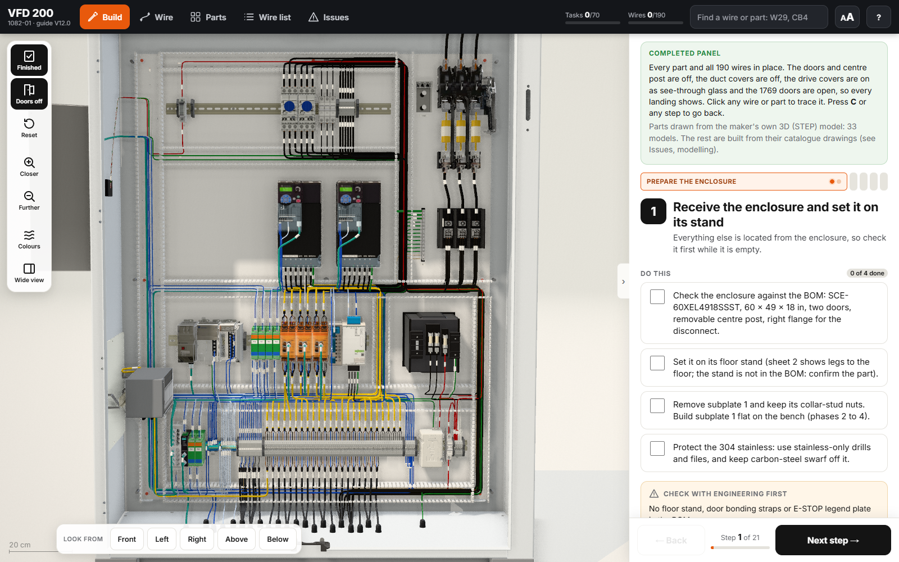
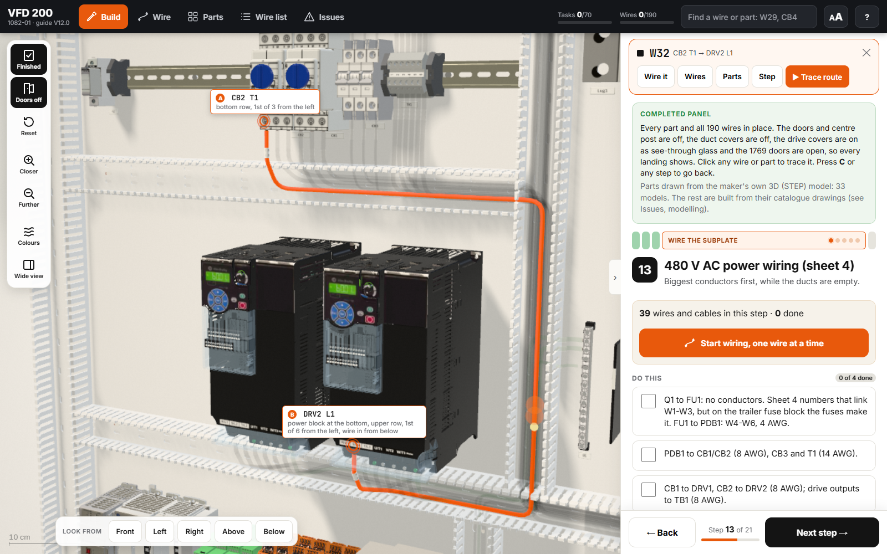
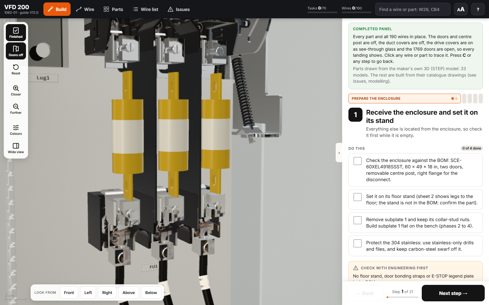
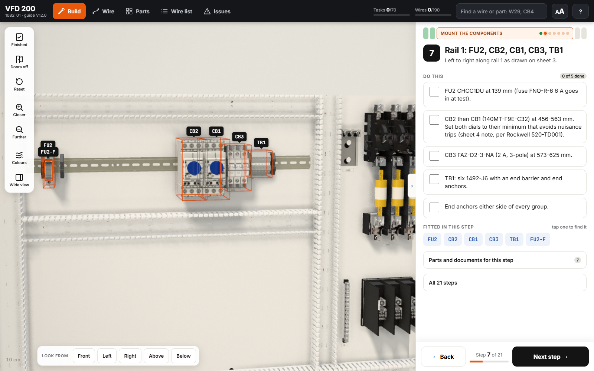

# Panel Twin Skill

Give Claude a control panel's drawing set. It builds an interactive 3D assembly and wiring guide of that panel in one HTML file: every device at real size from the makers' own models, every wire followed from clamp to clamp, and a screen laid out for the person doing the build.

A Claude Code skill, made at CPME from the VFD 200 panel twin (job 1082-01). The framework follows Airsup's [machine-skill](https://github.com/AirsupHQ/machine-skill): a `SKILL.md`, a kit, worked examples, scripts that let Claude look at its own output, and evals.



## Quick start

```sh
# 1. Put this folder where Claude Code finds skills
#    (copy or link it as  ~/.claude/skills/panel-twin )

# 2. Prove the toolchain on a copy of the worked example (nothing in the skill folder is changed)
node scripts/new_panel.mjs "C:/temp/panel-twin-try/Assembly Guide V1.0"
node "C:/temp/panel-twin-try/Assembly Guide V1.0/build.mjs"
node scripts/audit_headless.mjs "C:/temp/panel-twin-try/Assembly Guide V1.0" --max-kinks 2   # AUDIT: PASS, about 10 s
node scripts/shot.mjs "C:/temp/panel-twin-try/Assembly Guide V1.0" "C:/temp/panel-twin-try/whole.png" --complete

# 3. Ask Claude
#    "Build a panel twin for job 1234 from <drawing set>.pdf"
#    "In the VFD 200 guide, move ... as a new version and make sure nothing else broke"
```

Open `examples/vfd200/VFD200 Assembly Guide.html` in Chrome or Edge to use the example guide itself. The guide needs internet wherever it is used: it loads three.js from jsDelivr and its fonts from Google Fonts.

## Gallery

| | |
|---|---|
|  |  |
| The finished panel, doors off | Wire by wire: marker, both ends, route |
|  |  |
| Parts from the makers' own models | A build step with its tasks |

## What you get

- **The guide**: one self-contained HTML page. Build steps with tick boxes, a wire-by-wire mode, a parts list with documents, a wire list with marker CSV, run sheet and cut list, and the issues for engineering.
- **Real parts**: devices from the makers' STEP models at real size; terminal blocks behind covers built from the manuals; fuses as parts.
- **Real landings**: each wire goes into the opening of its terminal, leaves the way it would be dressed, and is rounded to a bend the wire can make.
- **An audit**: a command that walks every conductor through the model and fails if a wire passes through a solid, crosses a device it does not land on, shares a line with another, or was not drawn.
- **A review method**: how to read a drawing set that has no text layer against the wire list, with independent readers.
- **A worked example**: the complete VFD 200 guide and its source, with the record of twelve review rounds.

## Install

Copy this folder to `~/.claude/skills/panel-twin` (or link it there). It needs:

- Node 18 or later
- Python 3 with `pymupdf` and `pillow` (`pip install pymupdf pillow`)
- Microsoft Edge or Google Chrome (for the command-line audit and pictures)
- internet access (the guide loads three.js from jsDelivr)
- for converting STEP files: `npm install` in the guide's `tools/` folder; for the fallback reader, `pip install cascadio trimesh numpy` in a virtual environment

## Usage

Ask in plain words. The skill triggers on requests like:

- "Build a panel twin / 3D assembly guide for this panel from the drawings"
- "Turn this drawing set into something the shop can build from"
- "Check the wiring diagram against the wire list"
- "The wires on PWS1 look wrong in the guide" / "there are still oddities"

Claude starts a new guide from the worked example with `scripts/new_panel.mjs`, replaces the panel's data file by file, and audits after every step.

## How it works

| Piece | What it does |
|---|---|
| `SKILL.md` | The workflow and the bar |
| `references/` | Inputs, models, landings, the engine map, review, the screen, lessons |
| `examples/vfd200/` | The worked example: source, data, converted models, and the built guide |
| `examples/drawings/` | The example's drawing set (Draft rev18, 18 sheets, no text layer) |
| `scripts/new_panel.mjs` | Starts a new guide from the example, with a checklist that says what to expect at each step |
| `scripts/new_version.mjs` | Starts the next version of a guide for a review round |
| `scripts/audit_headless.mjs` | Runs the audit in headless Edge or Chrome; prints the page's script error if it did not load |
| `scripts/diff_routes.mjs` | Compares two versions wire by wire: what is new, gone, or moved |
| `scripts/shot.mjs` | Takes a picture of the guide at a step, a part, a wire or a camera position, or of a model in the viewer |
| `scripts/serve.mjs` | Serves a guide folder for a browser pane |
| `scripts/sheet_tiles.py` | Cuts drawing sheets into readable tiles |
| `scripts/fix_mojibake.py` | Repairs text saved through the wrong encoding |
| `evals/evals.json` | Test prompts and what a good result looks like (do not show it to an agent you are testing) |
| `REVIEW.md` | The skill's own review and test record, with the reviewers' comments |

## Limits

- **Revising a guide is tested; a brand-new panel is not yet.** The engine is one working guide, not a library. A new panel means replacing data files and the panel-specific blocks of `src/guide.js` (`references/engine-map.md` lists them), and the guide does not stay working at every step of that. Panels close to the example (a subplate with ducts and DIN rails, Rockwell, WAGO, Phoenix, ifm parts) will be quickest. See `REVIEW.md`.
- `AUDIT: PASS` means nothing collides. It does not mean the guide is right.
- One enclosure, one main subplate, a side plate and door devices. Multi-bay line-ups are not modelled.
- Makers' models must be fetched by a person where the source needs a login or a CAPTCHA.
- The audit finds collisions, not wrong terminals: the looking and the drawing review are part of the job.
- Nothing here checks a guide against the real panel. Photos help; a walk-down on the bench is still the last word.

## Credits

- The renderer, `vendor/lab-kit.js`, is the kit from Airsup's Machine Skill (MIT).
- three.js 0.170 from jsDelivr.
- The example's drawings, photos and job data are CPME's (job 1082-01).

Internal CPME use.
